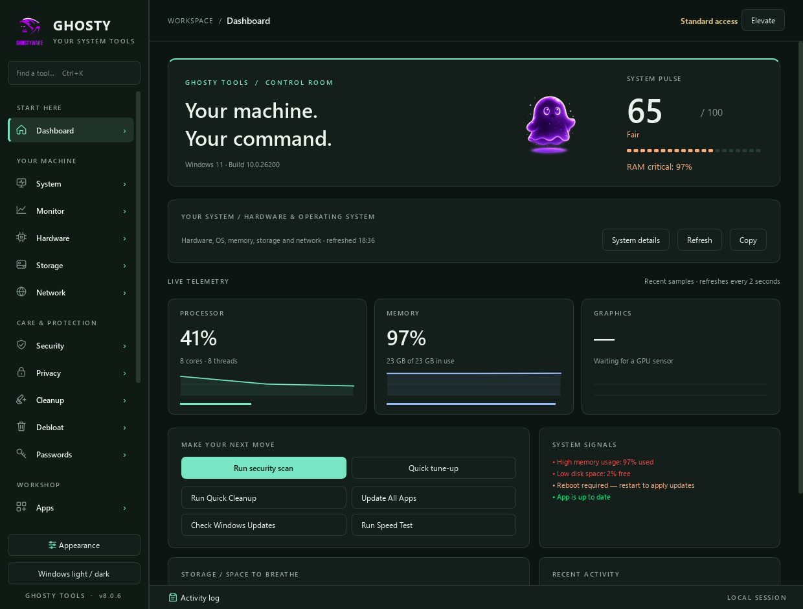
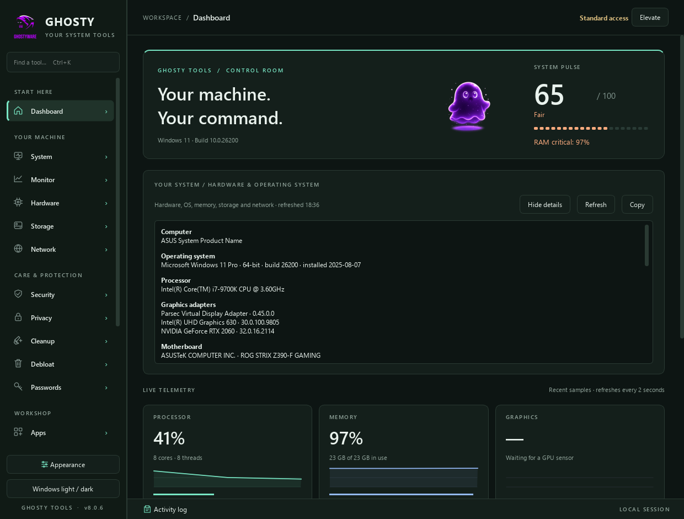

# Ghosty workspace

The interface uses a compact tool rail, grouped navigation, a searchable tool
list, a segmented system-health readout and graphs of recent usage samples.
The activity log opens from the footer; task progress stays visible when the
log is closed. Ctrl+K focuses tool search and Enter opens the first result.

The new default preset is **Ghost Mint**. Existing saved themes and custom
colours remain in place. Choose **Appearance > Ghost Mint** to try the new
palette on an existing installation. Shared colours and widget styles live in
`src/utils/theme_manager.py`; shared widgets and vector icons live in
`src/gui/dashboard.py` and `src/gui/icons.py`.

The dashboard uses `images/ghostmascot.png` when available. It hides the mascot
on narrower windows to keep the controls and health reading readable.
The top-left brand mark and the window icon use `images/logo.png`.

The **Your system** panel collects hardware and operating-system details in the
background. **System details** expands the combined report; **Refresh** collects
again and **Copy** copies the report. Windows uses CIM instead of the removed
WMIC command. Fields the system cannot supply are marked as not reported.

The headless checks build the real pages with background workers and prompts
disabled, and cover page routing, search, platform filtering, graph samples,
theme settings, progress visibility and startup-status display.

```powershell
python -m unittest discover -s tests -p "test_*.py" -v
```

Set `GHOSTY_PREVIEW_PATH` to an absolute PNG path when running the tests to
export a preview using live CPU, memory and storage readings. The graphics
readout stays unavailable until a GPU sensor supplies a reading.





## Windows update restart

The updater stages a separate PowerShell helper and manifest before the app
exits. It removes inherited PyInstaller runtime variables and resets the DLL
search directory for the helper. The new EXE starts with
`PYINSTALLER_RESET_ENVIRONMENT=1`, so it extracts a fresh Python runtime.
It never deletes any `_MEI` directory.

The helper waits for the old process and file locks, verifies its staged copy,
replaces the EXE while retaining the previous one, and reopens it. A failure to
launch the replacement restores the previous executable. Its log lives beside
the helper in the update download directory.

Install a build containing this fix manually once if your installed updater
still uses the old batch script. An old EXE's embedded updater cannot be changed
by editing these source files.

## What's New

`config/release_notes/v8.0.6.md` supplies the Info page and the one-time release
notes popup. Bundled notes work offline. The acknowledgement records a notes
revision so revised v8.0.6 notes can be shown once even if that version was
previously acknowledged. Notes for other versions are fetched by their exact
release tag.
